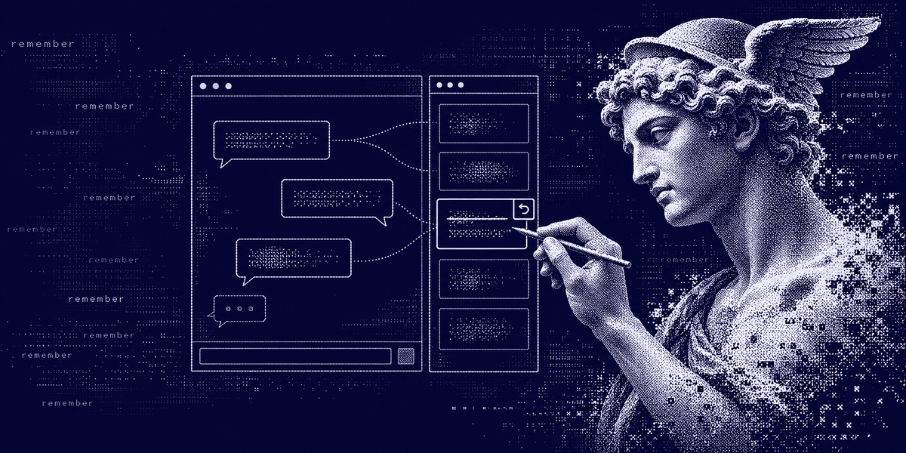
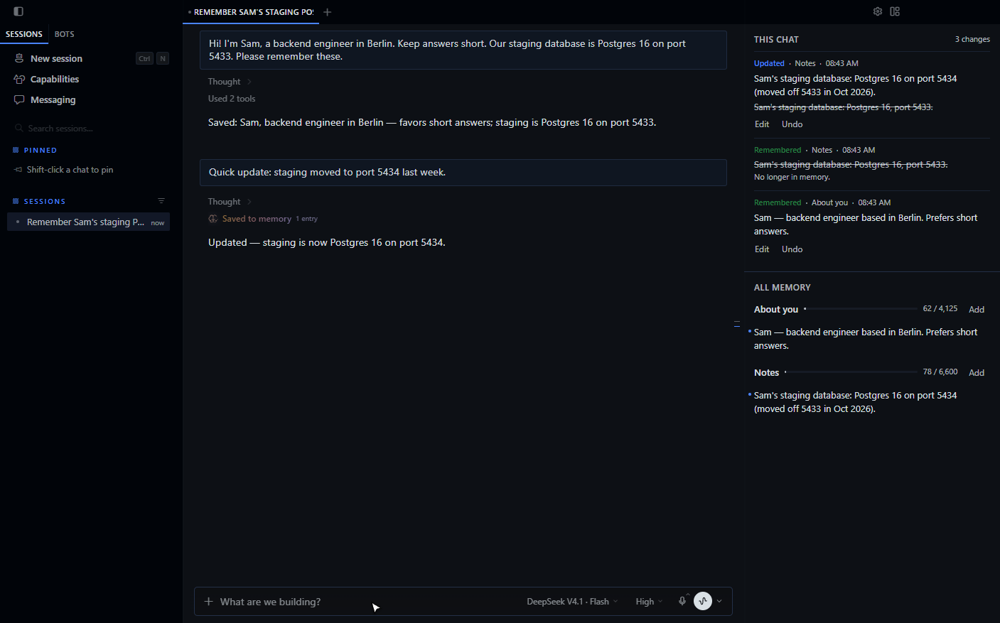

<div align="center">

  <a href="https://github.com/NousResearch/hermes-agent">
    
  </a>

  # Memory Pane

  **See what Hermes remembered in this chat. Fix it in one click.**

  A Hermes Desktop pane for the built-in memory. Everything Hermes saves, updates or forgets in the chat you are looking at appears beside it, live.
  Edit an entry, delete it, or undo what the agent did, without leaving the conversation.

  <sub>POWERED BY <a href="https://github.com/NousResearch/hermes-agent">HERMES AGENT</a> &nbsp;·&nbsp; COMMUNITY PLUGIN &nbsp;·&nbsp; VERSION 0.1.0</sub>

  <br /><br />

  [What it does](#memory-you-can-see) &nbsp;·&nbsp; [Watch the demo](https://github.com/Adolanium/hermes-memory-pane/releases/download/v0.1.0/memory-pane-demo.mp4) &nbsp;·&nbsp; [Install it](#make-it-yours) &nbsp;·&nbsp; [Where your data goes](#privacy-you-can-explain-in-one-breath)

</div>



## Powered by Hermes

Memory Pane is a community-built plugin for [Hermes Agent](https://github.com/NousResearch/hermes-agent). It reads the same `MEMORY.md` and `USER.md` files the built-in memory uses, and writes through Hermes's own memory store. It is not a memory provider and changes nothing about how Hermes remembers.

Two small halves do the work. A `tool_execution` middleware notes what each `memory` call changed and which chat made it. The Desktop pane shows those changes for the focused chat, next to everything in memory.



## Memory you can see

| | |
| --- | --- |
| **This chat**<br />Each change the focused chat made: **Remembered**, **Updated** with the old text struck through, and **Forgot**. Background memory review counts too, since it runs under the chat's session. | **All memory**<br />Every entry in **About you** (`USER.md`) and **Notes** (`MEMORY.md`), with how much of each character limit is used. Entries changed in this chat have a dot. |
| **Fix it**<br />Hover an entry to edit or delete it. **Add** writes a new one. | **Undo it**<br />Take back an entry Hermes added or updated, or **Restore** one it forgot. |

## Small decisions, already made

- Every write goes through Hermes's memory store, with the same file lock, character limits and injection scan the agent gets. A refused write shows Hermes's reason and changes nothing.
- Undo refuses when an entry has changed again since. Edit it directly instead, so nothing newer is lost.
- Hermes loads memory into the system prompt when a chat starts. Your fixes apply to new chats, and the pane says so after each one. Tell the current chat if it needs to know now.
- The recorder never changes, delays or retries a `memory` call. If memory can't be read, the call runs as usual and nothing is recorded.
- The pane polls every 4 seconds and follows whichever chat you focus.
- Recorded changes are kept for 90 days.

## Make it yours

### Install

```sh
hermes plugins install Adolanium/hermes-memory-pane --enable
```

Restart Hermes. Then turn on **Memory** in **Capabilities → Plugins** and open it on the right (**Ctrl+J**), or run **Open memory pane** from the command palette.

Memory Pane needs Hermes Agent 0.22.2 or later, with Hermes Desktop.

### Profiles

The agent half records per profile. Install and enable it in every profile you want to follow:

```sh
hermes -p <profile> plugins install Adolanium/hermes-memory-pane --enable
```

### Check it

```sh
hermes plugins validate . --install-deps
```

## Privacy you can explain in one breath

```text
memory tool call  →  read MEMORY.md / USER.md before and after  →  changes.sqlite3 in your Hermes home  →  the pane
```

- **What it reads.** `MEMORY.md` and `USER.md` in the active profile's `memories` folder, around each `memory` call and while the pane is open.
- **What it writes.** Memory entries, only when you edit, delete, add or undo in the pane. Its own change log at `$HERMES_HOME/plugin-data/hermes-memory-pane/changes.sqlite3`.
- **Nothing else.** No network calls, no credentials, no shell commands, no background processes, no telemetry.

## Compatibility

| Hermes Agent | Desktop | Status |
| --- | --- | --- |
| 0.22.2 (minimum) | Windows 11 | Tested by hand in the app |

## Limits

- Only the built-in memory is covered. External memory providers keep their own records.
- A call that replaces one entry shows as **Updated**. When one call changes several entries, an old and a new entry pair up only if their text is similar; otherwise they show as **Forgot** plus **Remembered**.
- Edits made outside Hermes, such as in a text editor, show in **All memory** but not in **This chat**.
- Changes made before the plugin was enabled are not in **This chat**.
- The pane reads the backend Desktop is connected to. A chat that belongs to another profile's backend shows after you switch to it.
- The plugin writes through `tools.memory_tool.load_on_disk_store`, a Hermes internal, so it shares the agent's lock and limits. A Hermes release that moves it needs a plugin update.

<br />

<div align="center">
  <strong>Memory Pane</strong><br />
  <sub>What your agent knows, in plain sight.</sub>
</div>

<br />

## License

[MIT](LICENSE).

> **Community project**
>
> Memory Pane is an independent community plugin. It is not affiliated with, endorsed by, sponsored by, or officially associated with [Nous Research](https://github.com/NousResearch) or the [Hermes Agent project](https://github.com/NousResearch/hermes-agent). Hermes, Hermes Agent and Nous Research are names and marks belonging to their respective owners.
